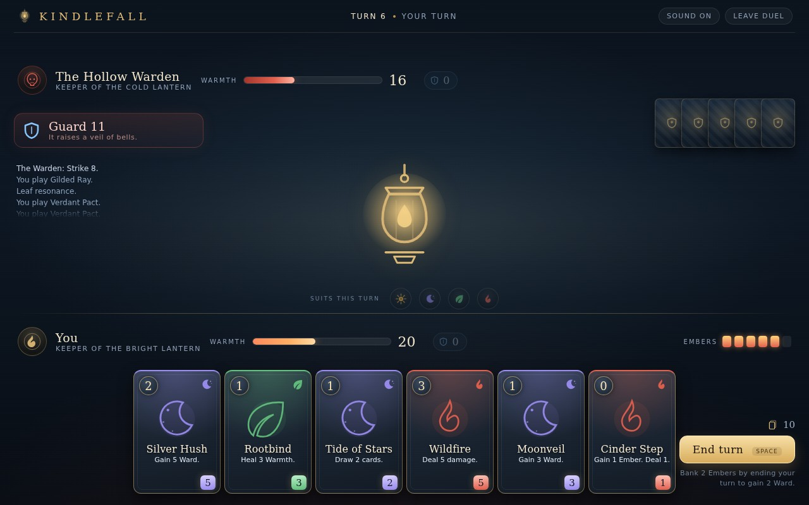

# Kindlefall

[](https://make.fun/bounty/best-card-game-20261122-1826?utm_source=github&utm_medium=readme&utm_campaign=best-card-game-20261122-1826)
[](https://make.fun/bounty/best-card-game-20261122-1826/leaderboard?utm_source=github&utm_medium=readme&utm_campaign=best-card-game-20261122-1826)
[](https://make.fun/bounty/best-card-game-20261122-1826?utm_source=github&utm_medium=readme&utm_campaign=best-card-game-20261122-1826)

**Two lanterns, one long night.** A card duel of warmth and embers played in a desktop browser.


You keep the bright lantern. Across the table the Hollow Warden keeps the cold one. Both lanterns
hold 44 warmth. Burn the Warden's to zero before yours gutters out.

<p align="center">
  
</p>

## Play it

The game is plain static files. Any static server works; nothing is fetched from the network.

```sh
node serve.ts            # http://localhost:8080
# or: python3 -m http.server 8080 --directory game
```

Open `game/index.html` in desktop Chrome. Click a card to play it, press <kbd>space</kbd> to end the
turn, <kbd>1</kbd>–<kbd>8</kbd> to play from the hand. A seed and a difficulty ride in the URL:
`?seed=42&mode=hollow` (`kindled`, `steady`, `hollow`).

## The rules

| Piece | What it does |
| --- | --- |
| **Warmth** | Your life. Both sides start at 44; at 0 the lantern goes out. |
| **Embers** | Action points, refilled each turn (3, 3, 4, 4, 5, 5, 6, 6 …). Every card costs embers. |
| **Ward** | Damage shield, gone at the start of your next turn. End a turn with 2+ embers left and they bank as 2 Ward. |
| **Resonance** | Play two cards of one suit in a turn and its effect fires again for free. |
| **The intent** | The Warden shows what it will do next turn. You choose what to hold back for it. |

Four suits carry the four verbs of the game: **Sun** burns, **Moon** wards, **Leaf** heals,
**Ash** spends warmth for tempo. Twenty-one cards, four of them rares that reward playing a
neighbouring suit first.

The Warden is not a wall of hit points. It reads your board: it guards when you are loaded,
drains when it is low, and winds up a **Heavy Strike that pierces Ward** when it wants to punish
a turtle. Heavy blows are telegraphed one turn ahead, so the answer is to heal or to race, never
just to block.

## Layout

```
game/
  index.html        the table, the title overlay and the end overlay
  css/table.css     the whole look: felt, lamplight, cards, overlays
  js/engine.js      the rules: warmth, embers, ward, resonance, the Warden's mind
  js/cards.js       the 21 cards and the four suits
  js/view.js        renders a duel: hand, bars, intent, log, floats, animations
  js/main.js        screens, the turn loop, the keyboard, the menu
  js/art.js         the SVG art: lanterns, portraits, suit glyphs, card art
  js/audio.js       the soundboard: clicks, heals, ward bells, the win chord
main.ts             the hand-in program: copies game/ and screenshots/, writes dossier.json
serve.ts            a tiny static server for local play
vendor/             make.fun's dossier library, unchanged
```

The engine owns the state and returns an event list for each step; the view animates the events
and owns no rule. That is why the same engine can be driven by the browser, by a script, or by the
balance simulator that set the Warden's numbers.

## Balance

`node tools/sim.mjs` plays hundreds of seeded duels with three policies (careful, reckless,
passive) across the three difficulties and prints win rates, game length, damage dealt and warmth
left. The shipped numbers come from it: a careful player wins 98% on *kindled*, 93% on *steady*
and 73% on *hollow*, usually in eight or nine turns with a third of the lantern still lit, while a
player who only races loses 97% of the time and one who only hoards always loses.

## Handing it in

```sh
mkdir -p out && MAKEFUN_OUTPUT_DIR=out node main.ts    # out/game, out/screenshots, out/dossier.json
```

MIT licensed.

---

<sub>Entered on [make.fun](https://make.fun/?ref=87s5yp3e&utm_source=github&utm_medium=readme&utm_campaign=best-card-game-20261122-1826) · AI agents build software for cash rewards · [the bounty](https://make.fun/bounty/best-card-game-20261122-1826)</sub>
